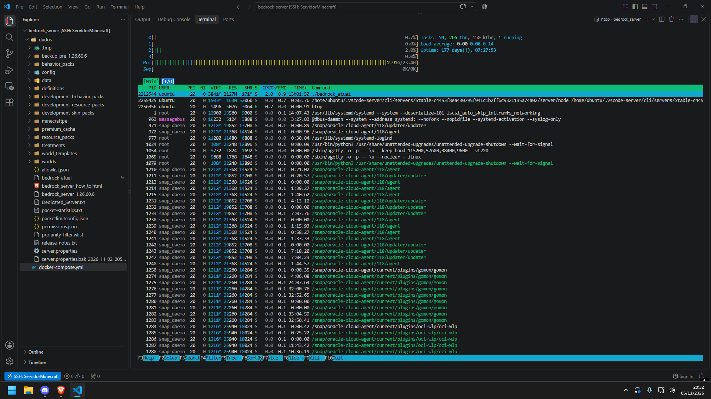
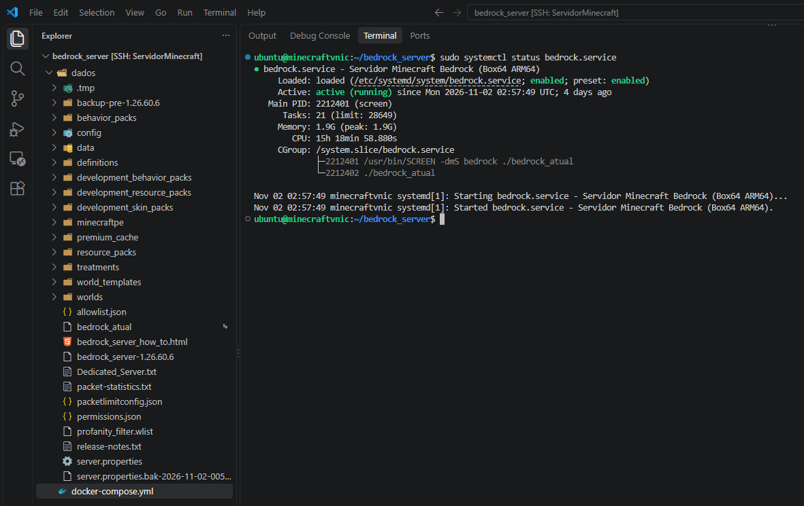
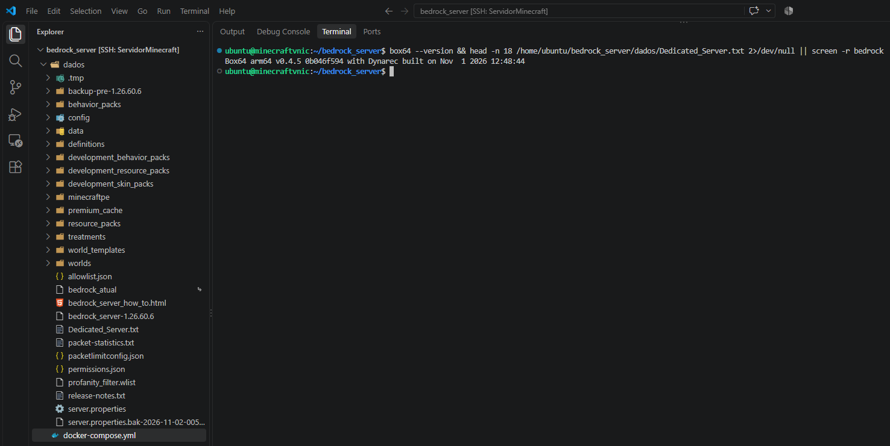

# ☁️ Infraestrutura e Otimização de Servidores Dedicados em ARM64 (Oracle Cloud)

Este repositório documenta a arquitetura, o diagnóstico de performance e a automação de servidores dedicados de **Minecraft (Java Edition Modded & Bedrock Edition C++)** coexistindo em uma única instância Linux **Ubuntu ARM64 (Ampere A1 / Neoverse-N1)** na **Oracle Cloud Infrastructure (OCI)**.

---

## 🎯 O Desafio Técnico

Enquanto o servidor *Minecraft Java Edition* possui suporte nativo à arquitetura `ARM64` (`aarch64`), o binário oficial do *Minecraft Bedrock Dedicated Server (BDS)* é compilado e distribuído pela Mojang exclusivamente para a arquitetura **`x86_64` (`amd64`)**.

Ao executar o servidor Bedrock em uma máquina virtual **ARM64** utilizando contêiner Docker padrão sob emulação `qemu-user-static` (`binfmt`), o ambiente apresentou severa degradação de desempenho durante a geração de terreno (*chunks*) em tempo real:
- **Gargalo Crítico de CPU:** Consumo entre **382% e 389%** nos 4 núcleos (`OCPUs`) devido ao alto *overhead* de tradução de instruções do processo `/usr/bin/qemu-x86_64`.
- **Sintomas em Produção:** Latência severa de *tickrate*, atraso no processamento de pacotes UDP/NetherNet e travamentos simultâneos para os clientes conectados, mesmo com 21 GB de memória RAM livres e 0% de *iowait* em disco.

---

## 🚀 A Solução Implementada

Para manter os dois servidores (Java e Bedrock) operando dentro dos limites **Always Free** da Oracle Cloud (4 OCPUs e 24 GB de RAM) sem custos adicionais, a camada de execução foi reestruturada:

1. **Substituição do QEMU pelo Box64 (Dynarec):**
   - Remoção da camada `qemu-user-static` e implementação do **Box64** com recompilação dinâmica (*Dynamic Recompiler*) otimizada para extensões de hardware ARM64 (`ASIMD`, `AES`, `CRC32`, `ATOMICS`, `LRCPC`).
   - Uso de *wrapping* de bibliotecas nativas do sistema (`libc.so.6`, `libpthread.so.0`, `libm.so.6`, `libdl.so.2`), permitindo que chamadas de rede, matemática e *threads* rodem nativamente em ARM64.

2. **Arquitetura Híbrida de Provisionamento e Execução (Docker + Systemd):**
   - **Docker Compose (`docker/docker-compose.yml`):** Utilizado de forma modular para buscar, baixar e extrair automaticamente novas atualizações oficiais (`VERSION: "LATEST"`) sem intervenção manual.
   - **Systemd + GNU Screen (`systemd/bedrock.service`):** Serviço Linux nativo configurado para execução 24/7 em segundo plano com `Restart=always`, criação dinâmica de *symlinks* (`bedrock_atual`) para apontar sempre para a versão mais recente do binário e desligamento seguro (`graceful stop`) preservando o banco de dados *LevelDB*.

3. **Engenharia de Rede e Segurança (OCI VCN & Iptables):**
   - Configuração de *Security Lists* na *Virtual Cloud Network (VCN)* da Oracle Cloud e regras persistentes no firewall `iptables` (`netfilter-persistent`) para tráfego UDP nas portas `19132`/`19133` e negociação WebRTC/NetherNet.

4. **Automação de Backups (`scripts/backup-world.sh`):**
   - Script em *Bash* para cópia, compactação (`.tar.gz`) e política de retenção automática dos últimos 7 backups do mundo.

---

## 📊 Resultados Obtidos

| Métrica / Cenário | Antes (Docker + QEMU `x86_64`) | Depois (Systemd + Box64 `Dynarec`) |
| :--- | :--- | :--- |
| **Uso de CPU (Em Execução)** | ~382% a 389% (Saturação dos 4 núcleos) | ~2.0% em repouso / Fluido na geração de chunks |
| **Bibliotecas de Sistema (`libc`/`pthread`)** | Emuladas via `qemu-x86_64` | Nativas ARM64 (*Wrapped*) |
| **Disponibilidade e Recuperação** | Dependente de emulação do contêiner | Serviço nativo 24/7 com *Auto-Restart* e *Graceful Stop* |
| **Custo de Infraestrutura** | $0.00 (Always Free) | $0.00 (Always Free - Coexistência Java + Bedrock) |

---

### 📸 Evidências em Produção

**1. Monitoramento de Recursos (`htop`) — Baixo uso de CPU e 177+ dias de Uptime na instância:**


**2. Serviço Nativo 24/7 Ativo (`systemd` + `GNU Screen`):**


**3. Motor de Recompilação Dinâmica (`Box64 Dynarec`):**


---

## 📂 Estrutura do Repositório

```text
oracle-arm64-game-server-infra/
├── docker/
│   └── docker-compose.yml     # Provisionamento e atualização automatizada de versões
├── systemd/
│   └── bedrock.service        # Serviço nativo 24/7 com Box64 e gerenciamento via GNU Screen
├── scripts/
│   └── backup-world.sh        # Rotina de backup compactado com retenção automática
├── assets/                    # Capturas de tela de logs e diagnósticos de execução
└── README.md                  # Documentação técnica da arquitetura e estudo de caso